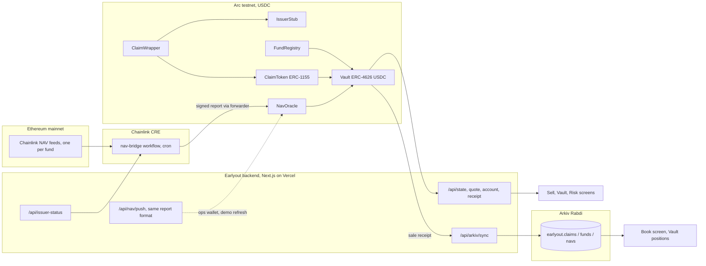
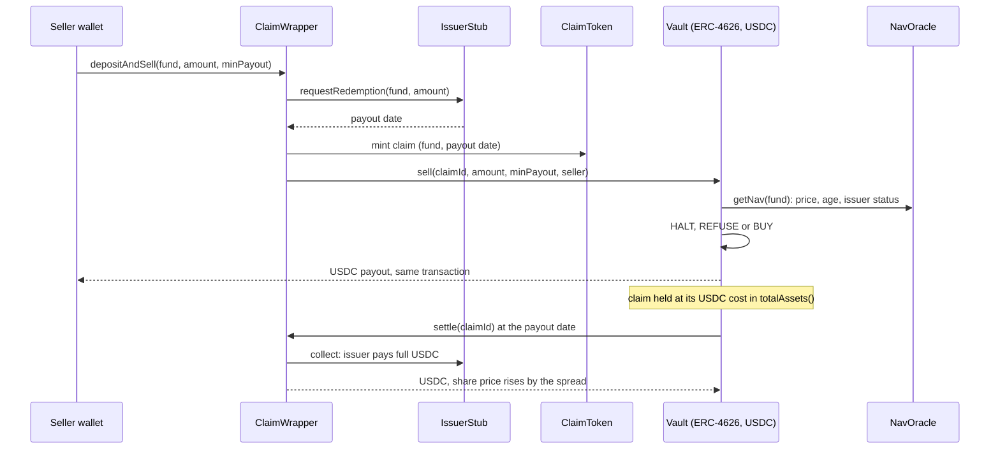
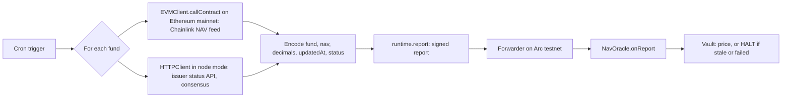
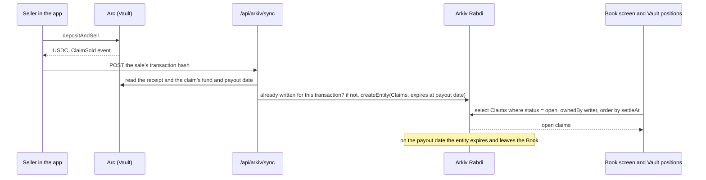

# Earlyout

Early exit for funds that redeem on a schedule.

Tokenized private credit funds let investors out once a quarter or once a month. Apollo's tokenized credit fund on Securitize (ACRED) repurchases at least 5% of the fund each quarter and pays once the underlying fund pays; it has no secondary market. An investor who needs cash before the next window has no way out.

Earlyout lets that investor sell their pending redemption today. The redemption becomes a claim token, the investor sells it to a USDC vault on Arc, and the vault collects from the fund when it pays. The price is the fund's real NAV, from Chainlink, minus a spread that names its four reasons. Every quote shows a verdict first: BUY, REFUSE or HALT. Every open claim is public on Arkiv until the day it pays.

Built at ETHGlobal Mumbai 2026, from scratch.

| | |
|---|---|
| Live app | https://earlyout.vercel.app |
| Arc Studio project | https://studio.arc.io/app/b9396e35-441e-4180-9444-965d2ad5dc59 |
| Repository | https://github.com/ETH-Global-Mumbai-2026/earlyout |
| Demo video | _to be filled at submission_ |

**Partner prizes we apply for**

| Partner | Prize | Section |
|---|---|---|
| Arc | Best Smart Contracts with Advanced Stablecoin Logic, in Arc Studio (also: Best DeFi / Onchain Finance App) | [Arc](#arc-usdc-settlement-built-in-arc-studio) |
| Chainlink | Best workflow with CRE | [Chainlink](#chainlink-cre-carries-nav-and-issuer-status-to-arc) |
| Arkiv | Build on Arkiv (from scratch) | [Arkiv](#arkiv-the-public-book-of-open-claims) |

## How it works

1. A holder deposits a fund token. ClaimWrapper files the redemption with the issuer and mints an ERC-1155 claim for that fund and payout date.
2. The holder sells the claim to the Vault and receives USDC in the same transaction.
3. The Vault holds the claim at cost, or sells it to a buyer, and collects the full amount at settlement. Liquidity providers (LPs) fund the vault in USDC and earn the spread.
4. NAV and issuer status arrive through NavOracle as Chainlink CRE reports. A failed issuer halts trading, and `markImpaired` writes that fund down inside `totalAssets()`, so every LP's share price falls in one transaction.
5. Each sale is written to Arkiv as an entity that expires on its payout date. The Book screen reads only from Arkiv.

| Verdict | When |
|---|---|
| BUY | The vault buys at the shown price |
| REFUSE | Over the fund's exposure cap, the vault lacks idle USDC, or the claim is already due |
| HALT | The issuer reports failure, the NAV is stale, or the fund is impaired |

Spread = base + vault usage + volatility × √(time to payout) + issuer credit. All four terms are on screen before the seller signs.

## Architecture



The browser never calls Arc's public RPC: reads, quotes, balances and transaction receipts go through our API, and the wallet only signs.

---

## Arc: USDC settlement built in Arc Studio

**Prize:** Best Smart Contracts with Advanced Stablecoin Logic, in Arc Studio. The same work also fits Best DeFi / Onchain Finance App (trading tokenized real-world assets, liquidity infrastructure).

### What the contracts do with USDC

Every balance in Earlyout is USDC on Arc (`0x3600...0000`, 6 decimals).

- **Multi-step settlement in one transaction.** `depositAndSell` takes the seller's fund tokens, files the redemption with the issuer, mints the claim, and has the Vault pay the seller USDC, all in one call. A `minPayout` guard reverts if the price moved.
- **Conditional flows on chain.** Every quote runs the same checks before any USDC moves: HALT if the issuer failed, the NAV is stale or the fund is impaired; REFUSE if the purchase would pass the fund's exposure cap or the vault's idle USDC, or if the claim is already due; otherwise BUY.
- **Stablecoin accounting in `totalAssets()`.** Claims are carried at their USDC cost until `settle` collects the full amount from the issuer, so the LP share price moves only on USDC that has actually arrived. Idle USDC is tracked apart from USDC tied up in claims, and withdrawals are capped at idle USDC, so claims are never sold to pay an LP out.
- **One-transaction write-down.** When the oracle reports a failed issuer, `markImpaired` writes that fund's claims down to their recovery value for every LP at once, and LP deposits and withdrawals pause until it is marked.
- **Reusable by other builders.** Nothing is ACRED-specific: any fund that redeems on a schedule can be listed in FundRegistry with its own payout delay, window, volatility, credit spread and USDC cap. Ten funds are listed today.

### Sale and settlement



### What Arc Studio did

The project started in Arc Studio. At 18:55 IST on 6 November we pitched Earlyout to Studio's agent and planned the build and the prize scope with it (Thread 1 of the project). The contract code was then drafted with Claude Code and brought back into the same Studio project at 20:46 (Thread 2), which:

1. installed the dependencies, ran our 50-test Foundry suite and its security review, fixed five Medium findings and added 13 tests (63 pass) ([`docs/studio/01-review-and-test.md`](docs/studio/01-review-and-test.md), [`02-security-review.md`](docs/studio/02-security-review.md));
2. created a Circle developer-controlled wallet in the workspace and deployed and configured all contracts from it, 34 transactions, then handed ownership to our ops wallet ([`03-deploy.md`](docs/studio/03-deploy.md), [`04-deployment-transactions.md`](docs/studio/04-deployment-transactions.md));
3. built a web app inside Studio against the deployed contracts ([`studio-app/`](studio-app), [`05-studio-web-app.md`](docs/studio/05-studio-web-app.md));
4. deployed eight more fund stand-ins on 7 November ([`06-more-funds.md`](docs/studio/06-more-funds.md)).

Circle tools used: USDC on Arc, Circle Wallets (the developer-controlled deployer), Arc Studio and its CLI (`arc-studio pull`).

### Code

| What | Where |
|---|---|
| The verdict: HALT and REFUSE checks | [`Vault.sol#L122`](https://github.com/ETH-Global-Mumbai-2026/earlyout/blob/main/contracts/src/Vault.sol#L122) |
| Sell: USDC to the seller | [`Vault.sol#L175`](https://github.com/ETH-Global-Mumbai-2026/earlyout/blob/main/contracts/src/Vault.sol#L175) |
| Settle: collect USDC from the issuer | [`Vault.sol#L222`](https://github.com/ETH-Global-Mumbai-2026/earlyout/blob/main/contracts/src/Vault.sol#L222) |
| One-transaction write-down | [`Vault.sol#L239`](https://github.com/ETH-Global-Mumbai-2026/earlyout/blob/main/contracts/src/Vault.sol#L239) |
| Idle USDC and `totalAssets()` | [`Vault.sol#L257`](https://github.com/ETH-Global-Mumbai-2026/earlyout/blob/main/contracts/src/Vault.sol#L257) |
| `depositAndSell` | [`ClaimWrapper.sol#L67`](https://github.com/ETH-Global-Mumbai-2026/earlyout/blob/main/contracts/src/ClaimWrapper.sol#L67) |
| Listing a fund (reuse) | [`FundRegistry.sol#L42`](https://github.com/ETH-Global-Mumbai-2026/earlyout/blob/main/contracts/src/FundRegistry.sol#L42) |
| Tests, including end to end | [`contracts/test/`](https://github.com/ETH-Global-Mumbai-2026/earlyout/tree/main/contracts/test) |
| Web app's sell, deposit and withdraw calls | [`web/src/lib/source/chain.ts`](https://github.com/ETH-Global-Mumbai-2026/earlyout/blob/main/web/src/lib/source/chain.ts) |

### Proof

- Studio's first deploy transaction: [`0xaee277…`](https://explorer.testnet.arc.io/tx/0xaee277c5d705aa62343818e0d7e3a1e8d41736d17cfc072e3f854620c2f5a1aa)
- A sale settled in USDC in one transaction: [`0x12aefa…`](https://explorer.testnet.arc.io/tx/0x12aefa9df1553daadc4c026566387f0fdde7cf9af6a0153a5eac5e141973a5ee)
- Settlement raising the LP share price to 1.011360: [`0x93ef49…`](https://explorer.testnet.arc.io/tx/0x93ef49119e451814a6a8fbc88035459404d375377b23af1583bf3fe990dcf008)
- A sale from a judge-style MetaMask wallet on 7 November: [`0x758bba…`](https://explorer.testnet.arc.io/tx/0x758bba8f26f7e66bba5478c40d8ecf8920e258bb5db4a18448ec6f37504e026a)

### Requirements

| Arc requirement | Where we meet it |
|---|---|
| Built in Arc Studio, shareable project URL | Studio project linked at the top. Studio has no public share option for projects, so the link opens for signed-in Studio users with access; every Thread 2 prompt and output is also mirrored in [`docs/studio/`](docs/studio) |
| Advanced stablecoin logic | Conditional verdicts, same-transaction multi-step settlement, USDC accounting and write-downs, above |
| Connected to a web app | [earlyout.vercel.app](https://earlyout.vercel.app) and the Studio-built app in [`studio-app/`](studio-app) |
| Working frontend and backend, architecture diagram | Live app, API routes in [`web/src/app/api/`](web/src/app/api), diagrams above |
| Video and documentation | Demo video at the top; this README and `docs/` |

---

## Chainlink: CRE carries NAV and issuer status to Arc

**Prize:** Best workflow with CRE.

### What the workflow does

[`cre/nav-bridge`](cre/nav-bridge) is the orchestration layer between Ethereum, an off-chain API and Arc. On a cron trigger, for each of the ten listed funds it:

1. reads the fund's Chainlink NAV feed on **Ethereum mainnet** with `EVMClient.callContract` (`latestRoundData`, at the last finalized block);
2. asks the **issuer status API** (`/api/issuer-status`) with `HTTPClient`, in node mode with identical-answer consensus;
3. encodes `(fund, nav, navDecimals, updatedAt, status)`, signs it with `runtime.report`, and calls `writeReport` to **NavOracle on Arc testnet** through the forwarder.

Each fund runs in its own try/catch, so one bad feed does not stop the others, and the run stays within CRE's default read quota with all ten funds.

**Why it matters in the product:** the Vault prices every sale from what this workflow writes, and halts on it. A stale NAV or a FAILED issuer status turns every quote for that fund into HALT, and allows `markImpaired` to write it down.



### Code

| What | Where |
|---|---|
| Read a mainnet NAV feed at the finalized block | [`main.ts#L60`](https://github.com/ETH-Global-Mumbai-2026/earlyout/blob/main/cre/nav-bridge/main.ts#L60) |
| Issuer status over HTTP | [`main.ts#L74`](https://github.com/ETH-Global-Mumbai-2026/earlyout/blob/main/cre/nav-bridge/main.ts#L74) |
| Per-fund loop, node-mode consensus, `writeReport` | [`main.ts#L87`](https://github.com/ETH-Global-Mumbai-2026/earlyout/blob/main/cre/nav-bridge/main.ts#L87) |
| Cron trigger | [`main.ts#L126`](https://github.com/ETH-Global-Mumbai-2026/earlyout/blob/main/cre/nav-bridge/main.ts#L126) |
| Ten funds and their feeds | [`config.production.json`](https://github.com/ETH-Global-Mumbai-2026/earlyout/blob/main/cre/nav-bridge/config.production.json) |
| Receiver: `onReport` and the workflow check | [`NavOracle.sol#L77`](https://github.com/ETH-Global-Mumbai-2026/earlyout/blob/main/contracts/src/NavOracle.sol#L77) |
| Where the vault halts on the report | [`Vault.sol#L142`](https://github.com/ETH-Global-Mumbai-2026/earlyout/blob/main/contracts/src/Vault.sol#L142) |
| The external API it calls | [`web/src/app/api/issuer-status/route.ts`](https://github.com/ETH-Global-Mumbai-2026/earlyout/blob/main/web/src/app/api/issuer-status/route.ts) |

### Proof

Simulated with `cre workflow simulate --broadcast` against Arc testnet, three times, including the failure path:

- issuer OK: [`0xbeb579…`](https://explorer.testnet.arc.io/tx/0xbeb579c3af949e857109a542ee9a03374f853dd7399062f2f7cd9ab7dba5622f)
- issuer FAILED, trading halts: [`0x4fd0f3…`](https://explorer.testnet.arc.io/tx/0x4fd0f3d19eb5b105d84696f71fa9fae2b026a0df552e03dd827e31986b2c5df7)
- restored: [`0xc2ba3f…`](https://explorer.testnet.arc.io/tx/0xc2ba3ffbce7b1d6543bc80251919a17446fe9de133f3670cd44a5875a5b2540f)

The logs, plus a ten-fund run under CRE's default limits, are in [`cre/README.md`](cre/README.md).

**What runs live today:** between simulations the oracle's forwarder is our ops wallet, and the app's "Refresh NAV" button calls [`/api/nav/push`](web/src/app/api/nav/push), which reads the same Chainlink feeds and writes the identical report format. The contracts cannot tell the two apart; moving the forwarder to the CRE network is one `setForwarder` call.

### Requirements

| CRE requirement | Where we meet it |
|---|---|
| A CRE workflow used as an orchestration layer | `nav-bridge` is the designed path from Chainlink NAV and issuer status to the contracts; between simulations `/api/nav/push` writes the identical report |
| Integrates a blockchain with an external API or data source | Ethereum mainnet feeds and an HTTP API in, a signed report to Arc out |
| Successful simulation through the CRE CLI | Three broadcast runs with transaction hashes, above |
| Meaningfully used | Every quote's price and every HALT come from the report it defines, delivered by the workflow in simulation and by `/api/nav/push` between simulations |

---

## Arkiv: the public book of open claims

**Prize:** Build on Arkiv (from scratch).

### What lives on Arkiv

The Book is a public, queryable list of every open claim the vault holds: fund, units, USDC paid, NAV, the four spread terms, payout date, seller, holder and the Arc transaction. A fund distributor, an LP or a judge can read it with one query against the public RPC, without our server.

| Entity | One per | Expires | Who writes |
|---|---|---|---|
| `earlyout.claims` | sale | at the claim's payout date, so it leaves the Book on its own | writer wallet |
| `earlyout.funds` | listed fund | one day after its last refresh, so a stopped indexer cannot leave stale prices | writer wallet |
| `earlyout.navs` | NAV update | 30 days | writer wallet |
| `earlyout.cursor` | indexer position | 180 days | writer wallet |

Writer wallet: `0x343F684dAFFf216CDf38a40888662148eBa07Fd7` on Rabdi (chain 7794095). Every read filters `ownedBy` that wallet, because any wallet can write entities under our schema name.



### Query it yourself

```bash
cd web && pnpm install && pnpm arkiv:query   # Node 22.10 or later
```

It runs `select().from(earlyout.claims).where(eq("status","open")).ownedBy(writer).orderBy(asc("settleAt"))` against the public RPC ([`web/scripts/arkiv-query.ts`](web/scripts/arkiv-query.ts)). Or open the [Book](https://earlyout.vercel.app/book): every row links to its Arkiv entity, for example [`0x8b5a02…`](https://rabdi.explorer.arkiv.network/entity/0x8b5a025e908409787e1993bc8b59e628b0dfc6eba04847a9063c34e575b25210).

### Code

| What | Where |
|---|---|
| The four schemas and their indexed fields | [`schema.ts`](https://github.com/ETH-Global-Mumbai-2026/earlyout/blob/main/web/src/server/arkiv/schema.ts#L6) |
| One entity per sale, expiring at the payout date | [`sync.ts#L101`](https://github.com/ETH-Global-Mumbai-2026/earlyout/blob/main/web/src/server/arkiv/sync.ts#L101) |
| Index a sale from its receipt, seconds after it happens | [`sync.ts#L146`](https://github.com/ETH-Global-Mumbai-2026/earlyout/blob/main/web/src/server/arkiv/sync.ts#L146) |
| Block scan for buys, settlements and NAV history | [`sync.ts#L175`](https://github.com/ETH-Global-Mumbai-2026/earlyout/blob/main/web/src/server/arkiv/sync.ts#L175) |
| The Book's read: open claims, `ownedBy` writer | [`read.ts#L52`](https://github.com/ETH-Global-Mumbai-2026/earlyout/blob/main/web/src/server/arkiv/read.ts#L52) |
| Book screen | [`web/src/app/(app)/book/page.tsx`](<https://github.com/ETH-Global-Mumbai-2026/earlyout/blob/main/web/src/app/(app)/book/page.tsx>) |
| Vault positions, also read from Arkiv | [`web/src/app/(app)/vault/page.tsx`](<https://github.com/ETH-Global-Mumbai-2026/earlyout/blob/main/web/src/app/(app)/vault/page.tsx>) |

### Requirements

| Arkiv requirement | Where we meet it |
|---|---|
| Built from scratch at ETHGlobal Mumbai | See [the build timeline](#build-timeline) |
| Writes to Arkiv's current testnet with `@arkiv-network/sdk` | Rabdi, chain 7794095, from [`sync.ts`](web/src/server/arkiv/sync.ts) |
| A feature users see reads from Arkiv | The Book screen and the Vault's positions read only from Arkiv |
| Writer wallet and one runnable query in the README | Above |
| [`arkiv/schema.md`](arkiv/schema.md) | Entities, queried fields, owners, expiry |
| [`arkiv/friction.md`](arkiv/friction.md) | Arkiv feedback, 25% |
| [`arkiv/reach.md`](arkiv/reach.md) | Reach, 25% |
| [`arkiv/why-arkiv.md`](arkiv/why-arkiv.md) | Why Arkiv, 25% |
| [`arkiv/how-you-use-arkiv.md`](arkiv/how-you-use-arkiv.md) | How we use Arkiv, 25% |
| Public repo, open-source licence, AI use stated | MIT; [`docs/ai-usage.md`](docs/ai-usage.md) |

---

## Contracts (Arc testnet, chain 5042002)

| Contract | Address | Job |
|---|---|---|
| FundRegistry | [`0x634697188F17eC1064f6e9A0aE000a504983dCe4`](https://explorer.testnet.arc.io/address/0x634697188F17eC1064f6e9A0aE000a504983dCe4) | Listed funds and their terms |
| NavOracle | [`0xCd55924a73771d508887905473d93B981ac4A08b`](https://explorer.testnet.arc.io/address/0xCd55924a73771d508887905473d93B981ac4A08b) | CRE receiver: NAV, timestamp, issuer status |
| IssuerStub | [`0x2b492aD36D8BB7BA6341a06AF76f1614A9516Ebe`](https://explorer.testnet.arc.io/address/0x2b492aD36D8BB7BA6341a06AF76f1614A9516Ebe) | Stand-in issuer: queues redemptions, pays NAV after the delay |
| ClaimToken | [`0x39006ed8b5a1f7c7cd7c6C33f522fF8C8e61B090`](https://explorer.testnet.arc.io/address/0x39006ed8b5a1f7c7cd7c6C33f522fF8C8e61B090) | ERC-1155 claims, allowlisted transfers |
| ClaimWrapper | [`0xfc7E6ECF94e88E050c73733aC3cf03f831115952`](https://explorer.testnet.arc.io/address/0xfc7E6ECF94e88E050c73733aC3cf03f831115952) | deposit, depositAndSell, collect, redeem |
| Vault | [`0x7A40b36b012DC19b1f42dd68C13F4daE312e2319`](https://explorer.testnet.arc.io/address/0x7A40b36b012DC19b1f42dd68C13F4daE312e2319) | quote, quoteFund, sell, buy, settle, markImpaired |
| ACRED (stand-in) | [`0xCd5DE841b0f781A866cA6E978A19d6d5431683E2`](https://explorer.testnet.arc.io/address/0xCd5DE841b0f781A866cA6E978A19d6d5431683E2) | 90-day payout, 1-day window |
| ACREDd (demo window) | [`0x8d9FF934E08DA9f8AEbF2280dAD218e8d176d06F`](https://explorer.testnet.arc.io/address/0x8d9FF934E08DA9f8AEbF2280dAD218e8d176d06F) | 15-minute payout, 5-minute window |
| JAAA (stand-in) | [`0x7ED73c4653aCf10830f2c5811349bc1d6bF012e1`](https://explorer.testnet.arc.io/address/0x7ED73c4653aCf10830f2c5811349bc1d6bF012e1) | 7-day payout; NAV from its Chainlink feed |
| JTRSY (stand-in) | [`0xAc28d2d4902a705f33C43816599BCaFD3bb194b3`](https://explorer.testnet.arc.io/address/0xAc28d2d4902a705f33C43816599BCaFD3bb194b3) | 1-day payout; NAV from its Chainlink feed |
| USTB (stand-in) | [`0x09367DC8779b7462f41d21ff2782c15D73f7B7D5`](https://explorer.testnet.arc.io/address/0x09367DC8779b7462f41d21ff2782c15D73f7B7D5) | 1-day payout; NAV from its Chainlink feed |
| USCC (stand-in) | [`0x3ff6d44727Cddd81271ca00A1e590818a24Ea3c9`](https://explorer.testnet.arc.io/address/0x3ff6d44727Cddd81271ca00A1e590818a24Ea3c9) | 3-day payout; NAV from its Chainlink feed |
| USTBL (stand-in) | [`0x577Ed63097665601609fC9381Ca229F15AeD30B6`](https://explorer.testnet.arc.io/address/0x577Ed63097665601609fC9381Ca229F15AeD30B6) | 1-day payout; NAV from its Chainlink feed |
| SAFO (stand-in) | [`0x5F10C72fF50fB94348d0F16234551f6872a857a2`](https://explorer.testnet.arc.io/address/0x5F10C72fF50fB94348d0F16234551f6872a857a2) | 1-day payout; NAV from its Chainlink feed |
| CASH+ (stand-in) | [`0x1869711fde2e7d089F3058228cF3AFF4C16a9658`](https://explorer.testnet.arc.io/address/0x1869711fde2e7d089F3058228cF3AFF4C16a9658) | 1-day payout; NAV from its Chainlink feed |
| Treasury+ (stand-in) | [`0xf767D26EE85e09389f410F28728f0Ddca37610e8`](https://explorer.testnet.arc.io/address/0xf767D26EE85e09389f410F28728f0Ddca37610e8) | 1-day payout; NAV from its Chainlink feed |

USDC on Arc: `0x3600000000000000000000000000000000000000`. Deployed at block 71057910 by Arc Studio from `0xC9007Afa7c9eCd6b0D9da62e3B820f69F730aFf3` (a Circle developer-controlled wallet) and owned by our ops wallet `0xbc832e4FC6a9CBd9c35884Bc744e6499cBFf537B`, so the deployer owns nothing. Addresses are also in [`contracts/deployments/`](contracts/deployments). Explorer: https://explorer.testnet.arc.io.

## What is real and what is a stand-in

| Real | Stand-in, and why |
|---|---|
| Fund NAV: Chainlink NAV feeds on Ethereum mainnet, one per fund: ACRED `0x35DDfB90011E686CCf837a6819562705076207EB` (8 decimals) and eight NAVLink feeds listed in `web/src/lib/glossary.ts` | Fund tokens: real ones only transfer between issuer-approved wallets |
| USDC on Arc, all Earlyout contracts, the Arkiv book | Issuer contract: same reason |
| The CRE workflow and its report path | Issuer status API: in production this is the issuer's attestation |

## Built at the event, and what we reused

Everything in this repository was written at ETHGlobal Mumbai, after hacking started on 5 November at 21:00 IST. No project code, designs or assets existed before the event; the [build timeline](#build-timeline) ties each step to an on-chain or hosted timestamp.

We reused only public libraries, unchanged:

| Area | Libraries |
|---|---|
| Contracts | OpenZeppelin Contracts 5 (ERC-4626, ERC-1155, Ownable, ReentrancyGuard), forge-std |
| Chainlink | `@chainlink/cre-sdk`, the CRE CLI, viem and zod; `IReceiver` follows the interface in Chainlink's CRE docs |
| Arkiv | `@arkiv-network/sdk` |
| Web | Next.js, React, wagmi, viem, TanStack Query, Tailwind CSS, Motion, lucide-react; the Averta font, licensed by the team; one shader component pasted from a public component library (`web/src/components/ui/portfolio-hero-with-paper-shaders.tsx`, see `docs/ai-usage.md`) |

## Repository layout

| Path | Contents |
|---|---|
| [`contracts/`](contracts) | Foundry project: `src`, `test`, `script/Deploy.s.sol`, `deployments/` |
| [`web/`](web) | Next.js app and API routes; Arkiv indexer in `src/server/arkiv/`; NAV pusher in `src/server/nav.ts` |
| [`cre/`](cre) | Chainlink CRE project and the nav-bridge workflow |
| [`studio-app/`](studio-app) | The app Arc Studio built in its own workspace against the deployed contracts (pulled with `arc-studio pull`; it runs in the Studio preview) |
| [`arkiv/`](arkiv) | Arkiv judging files |
| [`docs/`](docs) | `spec.md`, `build-plan.md`, `demo-script.md`, `ai-usage.md`, and the Arc Studio prompts and outputs in `studio/` |
| [`scripts/check.sh`](scripts/check.sh) | Local CI gate: forge test, lint, typecheck, build |

## Run it

```bash
cd web && cp .env.example .env.local   # fill in addresses, or NEXT_PUBLIC_MODE=mock for demo data
pnpm install && pnpm dev
```

Contracts: install the dependencies first (`cd contracts && forge install foundry-rs/forge-std OpenZeppelin/openzeppelin-contracts@v5.7.0 --no-git`, as CI does), then `forge test`. Note `Vault.sell(claimId, amount, minPayout, receiver)` takes a fourth argument, and `ClaimSold` emits `receiver`. Deploy: `forge script script/Deploy.s.sol --rpc-url arc_testnet --broadcast` with `NEW_OWNER` set.

Try it as a judge: open the [Sell](https://earlyout.vercel.app/sell) screen, connect a wallet on Arc testnet, press **Try as judge** to receive demo fund tokens and gas, sell 0.001 ACRED, then open the [Book](https://earlyout.vercel.app/book).

## Honest limits

- **Open finding, LP gain sniping (High, found by Arc Studio's review).** Claims sit in the vault at cost and the whole gain lands when `settle` runs, so capital that deposits just before a settlement and leaves right after takes a share of a gain earlier LPs funded. Reproduced in `docs/studio/poc/`. Accepted for the testnet demo, where the vault holds a few USDC. The fix before any real money is linear accrual of claim value to the payout date inside `totalAssets()`; the design is in `docs/studio/02-security-review.md`.
- The CRE workflow is simulated with `--broadcast`, not deployed to the CRE network. Between simulations our ops wallet is the oracle forwarder and writes the same reports; while it is, it could overwrite a status with a same-timestamp report.
- Settlement needs a keeper to call `settle` at maturity. Nothing settles on its own.
- The demo controls on the Risk screen act on the stand-in issuer, testnet only, and need a demo key.
- Ten listings fill FundRegistry's limit of ten. Earlyout is for funds that redeem on a schedule (ACRED, and ACREDd as its 15-minute demo). The other eight already pay within days, so the app shows them for comparison and does not offer to buy them; their payout terms on Arc are illustrative. The contract itself would still quote them if called directly.
- The Arkiv block scan (buys, settlements, NAV history) runs once a day by cron, or on a POST to `/api/arkiv/sync` with no body. Each sale is recorded from its receipt within seconds.

## Build timeline

We built and reviewed locally and committed in topic-sized batches, so most commits carry two timestamps on the evening of 6 November. The work itself is timestamped independently on Arc, Arkiv, Vercel and GitHub, and anyone can check it:

| Time (IST) | What happened | Proof |
|---|---|---|
| 5 Nov, 21:00 | Hacking starts at ETHGlobal Mumbai | event schedule |
| 6 Nov, 16:47 | Repository created: licence, README, build spec, Arkiv friction log | [first commits](https://github.com/ETH-Global-Mumbai-2026/earlyout/commits/main) |
| 6 Nov, 18:55 | Idea pitched to Arc Studio's agent in our Studio project; build and prize scope planned with it | Studio project, Thread 1 |
| 6 Nov, 20:46 | Contracts sent into our Arc Studio project (Thread 2); Studio installs dependencies, runs the suite and its security review, fixes five Medium findings | `docs/studio/01-review-and-test.md`, `02-security-review.md` |
| 6 Nov, about 21:00 | First deployment of the web app to Vercel | Vercel deployment list |
| 6 Nov, 21:42 | First deploy to Arc Testnet from our own wallet with forge (later superseded) | [tx](https://explorer.testnet.arc.io/tx/0x521ed165a9b18589b7ba634a2c3d64e94e96ba3ae5713cd3d4b5754c562d2fb5) |
| 6 Nov, 22:09 | Arc Studio deploys and configures all contracts from a Circle developer-controlled wallet: 34 transactions | [first tx](https://explorer.testnet.arc.io/tx/0xaee277c5d705aa62343818e0d7e3a1e8d41736d17cfc072e3f854620c2f5a1aa), `docs/studio/04-deployment-transactions.md` |
| 6 Nov, 22:51 | First real sale through `depositAndSell` | [tx](https://explorer.testnet.arc.io/tx/0x12aefa9df1553daadc4c026566387f0fdde7cf9af6a0153a5eac5e141973a5ee) |
| 6 Nov, 22:58 | Deployed backend pushes the Chainlink ACRED NAV to the oracle | [tx](https://explorer.testnet.arc.io/tx/0x2487d33f9c961ad1065d47296f9de53314a5ce8ba622818391a7452c70948c3f) |
| 6 Nov, 23:11 | Settlement of the demo claim; LP share price rises to 1.011360 | [tx](https://explorer.testnet.arc.io/tx/0x93ef49119e451814a6a8fbc88035459404d375377b23af1583bf3fe990dcf008) |
| 6 Nov, 23:11 | First entities written to Arkiv | [tx](https://rabdi.explorer.arkiv.network/tx/0x30c138ad4af752e5e6b19eb49e0e730a3917aab532ee8274a5d5b952e95e615a) |
| 6 Nov, 23:14 to 23:16 | Three CRE broadcasts: issuer OK, FAILED, restored | [OK](https://explorer.testnet.arc.io/tx/0xbeb579c3af949e857109a542ee9a03374f853dd7399062f2f7cd9ab7dba5622f), [FAILED](https://explorer.testnet.arc.io/tx/0x4fd0f3d19eb5b105d84696f71fa9fae2b026a0df552e03dd827e31986b2c5df7), [restored](https://explorer.testnet.arc.io/tx/0xc2ba3ffbce7b1d6543bc80251919a17446fe9de133f3670cd44a5875a5b2540f) |
| 6 Nov, 23:18 and 23:33 | Reviewed work committed in topic-sized commits; CI passes | GitHub Actions runs |
| 7 Nov, 00:00 | Arc Studio builds an app in its own workspace against the deployed contracts | `studio-app/`, `docs/studio/05-studio-web-app.md` |
| 7 Nov, about 02:00 | Arc Studio deploys eight more fund stand-ins, each priced from its own Chainlink NAV feed | [first tx](https://explorer.testnet.arc.io/tx/0x50ce522234e26b921cd7e8c42d48f682fced7e8ec2eefe750cda961ac919cd50), `docs/studio/06-more-funds.md` |
| 7 Nov, about 02:10 | Ops wallet lists them in FundRegistry and reports their Chainlink NAVs | [first listing](https://explorer.testnet.arc.io/tx/0xf2a12e5d056e8790fffa0bb6d041b0f136a80c93c4ea4c593b3775afa4949918) |
| 7 Nov, 05:00 to 05:45 | End-to-end QA with a real MetaMask wallet; 17 fixes in nine commits, including recording each sale on Arkiv from its receipt | commits `71ae001` to `eff70b2` |

From 7 November on, work is committed in small topic commits, several at a time after each round of review.

## For the submission form

**Arc, Best Smart Contracts with Advanced Stablecoin Logic in Arc Studio.** Seven contracts implement a multi-step USDC settlement: a holder's redemption becomes an ERC-1155 claim, the ERC-4626 vault buys it in the same transaction at NAV minus a four-term spread, collects USDC from the issuer at the payout date, and writes a failed fund down for every LP in one transaction. Conditional logic is on chain: every quote returns BUY, REFUSE or HALT from exposure caps, idle USDC, NAV staleness and issuer status. The contracts were tested and security-reviewed in Arc Studio (63 tests, five Medium findings fixed), deployed from a Circle developer-controlled wallet that Studio created, and connected to the web app at earlyout.vercel.app and to a Studio-built app in the project. Circle tools used: USDC on Arc, Circle Wallets (developer-controlled deployer), Arc Studio and its CLI. Feedback: Studio's deploy action creates one contract at a time and cannot run a Foundry script with follow-up calls, and Arc's USDC calls a blocklist precompile that Foundry's local simulation cannot execute, so any script that moves USDC fails in simulation.

**Arkiv, Build on Arkiv (from scratch).** The public book of open claims lives on Arkiv. Each sale on Arc becomes an entity that expires at its payout date; a fund directory expires a day after its last refresh; NAV history is kept for 30 days. The Book screen and the Vault's positions read only from Arkiv, filtered to our writer wallet. Feedback is in `arkiv/friction.md`; the main points: a named schema does not stop another wallet writing entities under it, so every read must filter by owner; and there is no unique key, so making a write idempotent takes a read first.

**Chainlink, Best workflow with CRE.** `cre/nav-bridge` reads the Chainlink NAV feed of each of the ten listed funds on Ethereum mainnet (ACRED, plus eight NAVLink feeds such as Janus Henderson's JAAA) and our issuer status API, and writes a signed report to NavOracle on Arc through the forwarder. The vault halts on what it writes. Simulated with `--broadcast` three times through the simulation forwarder (ACRED and ACREDd, including the failure path), plus a ten-fund dry run under CRE's default limits; logs in `cre/README.md`. Between simulations our server writes the identical report. Feedback: simulating with `--broadcast` against Arc worked first time once the oracle pointed at the mock forwarder. One snag: zod's `z.string().url()` in our config schema rejected a valid https URL inside the workflow runtime, which surfaced only as "Invalid URL" at engine start; a plain regex works.

## How we used AI

See [`docs/ai-usage.md`](docs/ai-usage.md) for the file-by-file record. In short: Arc Studio's agent reviewed, tested and deployed the contracts; Claude Code (Fable 5.1, later Opus 5.5) wrote the contracts' first draft, the web app, the indexer, the CRE workflow and these documents under our direction; every design decision, prompt and check was ours. The spec and planning files we directed it with are [`docs/spec.md`](docs/spec.md) and [`docs/build-plan.md`](docs/build-plan.md); every Thread 2 prompt sent to Arc Studio is in [`docs/studio/`](docs/studio).

## Licence

MIT.
