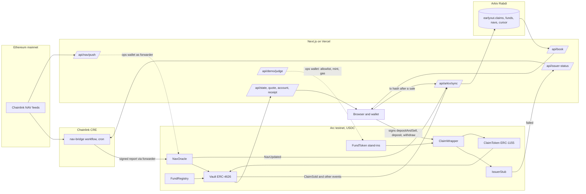
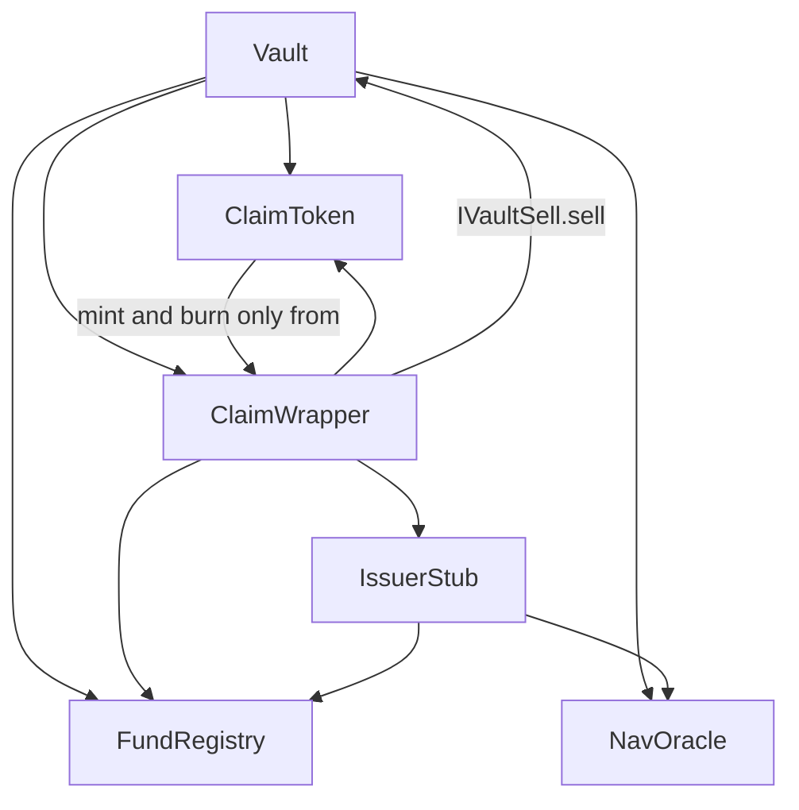
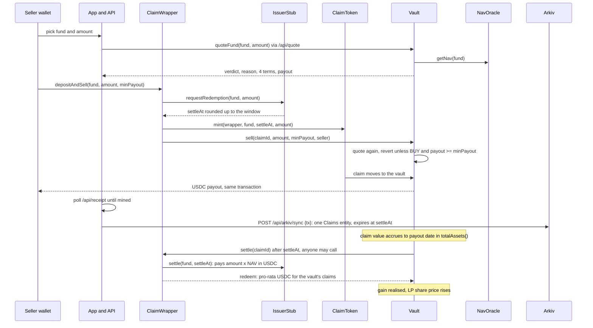
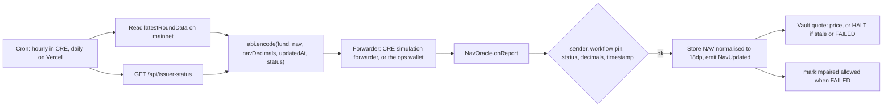

# 02. Architecture

## Components

| Component | Where it runs | Code | Job |
|---|---|---|---|
| Chainlink NAV feeds | Ethereum mainnet | external | One `latestRoundData()` feed per fund; the source of every price |
| `nav-bridge` workflow | Chainlink CRE (simulated) | `cre/nav-bridge/main.ts` | Reads each feed and the issuer status API, writes a signed report to NavOracle |
| NAV pusher | Next.js server on Vercel | `web/src/server/nav.ts`, `/api/nav/push` | Same report format, signed by the ops wallet, used while the ops wallet is the oracle forwarder |
| NavOracle | Arc testnet | `contracts/src/NavOracle.sol` | Stores NAV (18dp), timestamp and issuer status per fund; accepts reports only from the forwarder |
| FundRegistry | Arc testnet | `contracts/src/FundRegistry.sol` | Listed funds (max 10) and their pricing terms; global base and usage slope |
| FundToken | Arc testnet | `contracts/src/FundToken.sol` | Stand-in fund share with allowlisted transfers |
| IssuerStub | Arc testnet | `contracts/src/IssuerStub.sol` | Stand-in issuer: queues redemptions, pays NAV in USDC after the payout date, can be set to failed |
| ClaimToken | Arc testnet | `contracts/src/ClaimToken.sol` | ERC-1155 claims, one id per (fund, payout date), allowlisted transfers |
| ClaimWrapper | Arc testnet | `contracts/src/ClaimWrapper.sol` | Turns fund tokens into a claim; `depositAndSell` in one call; collects from the issuer and redeems claims pro rata |
| Vault | Arc testnet | `contracts/src/Vault.sol` | ERC-4626 over USDC: quotes, buys claims, sells them to buyers, settles, writes down impaired funds |
| Issuer status API | Next.js server | `/api/issuer-status` | The "outside API" CRE reads: `{"status":"OK"|"FAILED"}` from `IssuerStub.failed()` |
| Read API | Next.js server | `/api/state`, `/api/quote`, `/api/account`, `/api/receipt` | Serves all chain reads to the browser so it never calls Arc's public RPC |
| Arkiv indexer | Next.js server | `web/src/server/arkiv/sync.ts`, `/api/arkiv/sync` | Copies sales, buys, settlements and NAV updates from Arc to Arkiv |
| Arkiv book | Arkiv Rabdi testnet (chain 7794095) | schemas in `web/src/server/arkiv/schema.ts` | Public, self-expiring records of open claims, funds, NAV history and the indexer cursor |
| Book API | Next.js server | `/api/book`, `web/src/server/arkiv/read.ts` | Reads open claims and the fund directory from Arkiv only |
| Web app | Browser | `web/src/app` | Site pages and app screens; the wallet only signs |

## System diagram

## Contract dependencies

All references are immutable constructor arguments except two one-time links set after deploy: `ClaimToken.setWrapper` (can be set once) and `ClaimWrapper.setVault` (owner, can be changed). `setVault` also grants the vault `setApprovalForAll` over the wrapper's claims.

## Sale and settlement

## NAV and issuer status

Details in [05-oracle-and-cre.md](05-oracle-and-cre.md).

## Read path

The browser never calls Arc's public RPC for reads. Arc rate-limits per visitor IP, and early QA showed confirmations hanging for minutes. Instead:

- `/api/state` reads every listed fund (terms, NAV, impairment, cost, name, symbol) and the vault (total assets, deployed, supply, decimals, idle USDC, globals, share price) in one batched multicall, cached 10 seconds in memory and at the edge, with a last-good fallback of up to 5 minutes if Arc rate-limits.
- `/api/quote` calls `Vault.quoteFund` and caches each (fund, amount) for 10 seconds.
- `/api/account` reads a wallet's balances and vault position, cached 4 seconds.
- `/api/receipt` is polled by the browser after it sends a transaction.

The wallet (injected connector through wagmi) only signs. See [07-web-app.md](07-web-app.md).

## Trust boundaries

| Boundary | Who is trusted | For what |
|---|---|---|
| NavOracle forwarder | The ops wallet today; the CRE forwarder during simulations | Every NAV and every issuer status |
| Contract owner | The ops wallet `0xbc832e4FC6a9CBd9c35884Bc744e6499cBFf537B` | Listing funds and setting terms, allowlists, forwarder, workflow pins, issuer failure switch, `clearImpaired` |
| IssuerStub | The stand-in issuer must hold enough USDC to pay redemptions | Settlement |
| Arkiv writer | Wallet `0x343F684dAFFf216CDf38a40888662148eBa07Fd7` | The public book. Readers filter `ownedBy` this wallet |
| Next.js server | Holds the ops key, the Arkiv writer key and the demo tokens | Demo controls, NAV pushes, indexing |

Full threat model in [10-security.md](10-security.md).

## Decimals at a glance

| Value | Decimals |
|---|---|
| USDC (ERC-20 balance, all accounting) | 6 |
| Arc native gas balance (also USDC) | 18, never used for accounting |
| Fund token and claim amounts | 18 |
| NAV stored in NavOracle | 18 (normalised from the feed's own decimals) |
| Vault shares (`eoUSDC`) | 12 (USDC's 6 plus a decimals offset of 6) |
| Spread terms | basis points (1 bp = 0.01%) |
