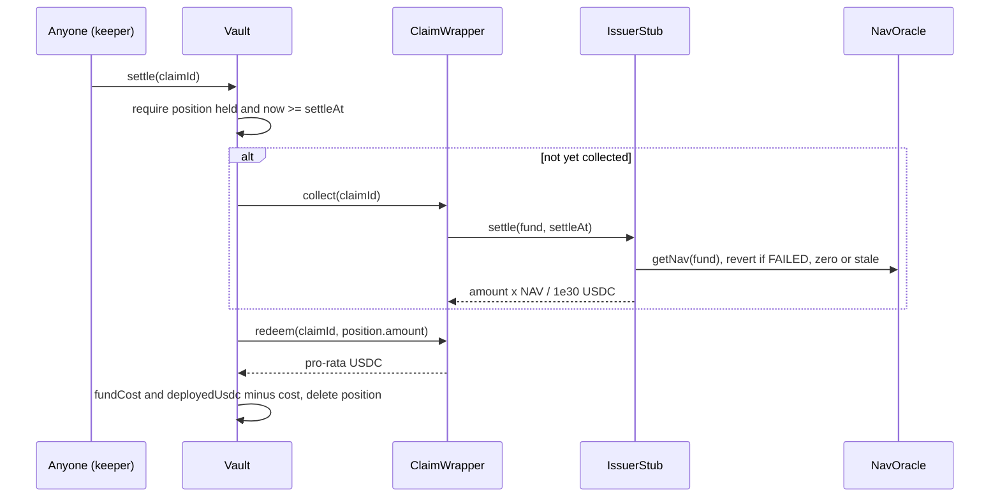

# 03. Contracts

Foundry project in `contracts/`. Solidity 0.8.28 (`solc_version` in `foundry.toml`, sources declare `^0.8.24`), EVM version cancun, optimizer on with 200 runs. Libraries: OpenZeppelin Contracts v5.7.0 and forge-std, installed into `contracts/lib/` (not committed).

| Contract | Lines | Inherits |
|---|---|---|
| `FundRegistry` | 88 | `Ownable` |
| `NavOracle` | 122 | `IReceiver` (ERC-165), `Ownable` |
| `FundToken` | 34 | `ERC20`, `Ownable` |
| `IssuerStub` | 83 | `Ownable` |
| `ClaimToken` | 71 | `ERC1155Supply`, `Ownable` |
| `ClaimWrapper` | 128 | `ERC1155Holder`, `Ownable` |
| `Vault` | 336 | `ERC4626`, `ERC1155Holder`, `Ownable`, `ReentrancyGuard` |
| `interfaces/IReceiver` | 9 | `IERC165`; Chainlink's CRE receiver interface |

Every `Ownable` contract uses OpenZeppelin's single-step `Ownable`, so `transferOwnership` and `renounceOwnership` are available to the owner (see [10-security.md](10-security.md)).

## FundRegistry

Listed funds and their pricing terms. Capped at `MAX_FUNDS = 10` so the vault can loop over funds in bounded gas.

**Terms struct**

| Field | Type | Meaning |
|---|---|---|
| `listed` | bool | Always forced to `true` when terms are set |
| `settlementDelay` | uint64 | Seconds from redemption request to payout. Must be non-zero |
| `window` | uint64 | Payout dates are rounded up to a multiple of this many seconds (0 = no rounding) |
| `maxAge` | uint64 | NAV older than this halts trading (seconds) |
| `volBps` | uint16 | Volatility term, scaled by the square root of years to payout |
| `creditBps` | uint16 | Issuer credit term |
| `recoveryBps` | uint16 | Value of claims after impairment, in bps of cost. Must be at most 10,000 |
| `exposureCapUsdc` | uint256 | Max USDC (6dp) the vault may have deployed in this fund, at cost |
| `symbol` | string | Display symbol |

**Globals:** `baseBps` and `utilSlopeBps` (uint16), set in the constructor and by `setGlobals`.

| Function | Access | Notes |
|---|---|---|
| `listFund(fund, terms)` | owner | Adds the fund if new (reverts `TooManyFunds` at 10), then sets terms. Re-listing does not duplicate |
| `setTerms(fund, terms)` | owner | Reverts `NotListed` for an unknown fund |
| `setGlobals(baseBps, utilSlopeBps)` | owner | |
| `isListed`, `getTerms`, `fundCount`, `fundAt(i)`, `funds()` | view | |

Events: `FundListed(fund, symbol)`, `TermsUpdated(fund)`, `GlobalsUpdated(baseBps, utilSlopeBps)`. Errors: `TooManyFunds`, `NotListed(fund)`, `BadTerms` (recoveryBps over 10,000 or zero delay).

There is no function to delist a fund.

## NavOracle

Receives NAV and issuer status reports. Covered in depth in [05-oracle-and-cre.md](05-oracle-and-cre.md).

| Item | Value |
|---|---|
| Storage per fund | `nav` (18dp), `updatedAt` (uint64), `status` (0 OK, 1 FAILED) |
| Constants | `STATUS_OK = 0`, `STATUS_FAILED = 1`, `MAX_FUTURE_DRIFT = 5 minutes` |
| Roles | `forwarder` (only sender `onReport` accepts), optional `expectedWorkflowOwner` and `expectedWorkflowId` (zero = off) |

| Function | Access | Notes |
|---|---|---|
| `onReport(metadata, report)` | forwarder | Decodes `(address fund, uint256 nav, uint8 navDecimals, uint64 updatedAt, uint8 status)`; checks and stores |
| `setForwarder(address)` | owner | |
| `setExpectedWorkflowOwner(address)` | owner | Pins reports to a CRE workflow owner |
| `setExpectedWorkflowId(bytes32)` | owner | Pins reports to one workflow id |
| `getNav(fund)` | view | `(nav, updatedAt, status)`; all zero for an unknown fund |
| `supportsInterface` | pure | `IReceiver` and `IERC165` |

Events: `ForwarderUpdated`, `ExpectedWorkflowOwnerUpdated`, `ExpectedWorkflowIdUpdated`, `NavUpdated(fund, nav, updatedAt, status)`. Errors: `InvalidSender`, `StaleReport`, `BadStatus`, `BadDecimals`, `FutureReport`, `BadMetadata`, `InvalidWorkflowOwner`, `InvalidWorkflowId`.

## FundToken

Stand-in fund share. ERC-20, 18 decimals (OpenZeppelin default). Every transfer that is not a mint or burn requires both `from` and `to` to be allowlisted.

| Function | Access |
|---|---|
| `setAllowlisted(account, allowed)` | owner |
| `mint(to, amount)` | owner |

Event: `Allowlisted(account, allowed)`. Error: `NotAllowlisted(account)`.

For a sale to work, the seller, `ClaimWrapper` and `IssuerStub` must all be allowlisted on the fund token.

## IssuerStub

Stand-in for a fund issuer's redemption desk. The owner pre-funds it with USDC.

| Function | Access | Notes |
|---|---|---|
| `requestRedemption(fund, amount)` | anyone | Pulls fund tokens, computes `settleAt = roundUp(block.timestamp + settlementDelay, window)`, records `pending[requester][fund][settleAt] += amount`, returns `settleAt` |
| `settle(fund, settleAt)` | the requester (reads `pending[msg.sender]`) | Pays `amount * nav / 1e30` USDC to the requester |
| `setFailed(bool)` | owner | Demo switch for issuer failure; `/api/issuer-status` reports this flag |

`settle` reverts, in order: `IssuerFailed` (stub flag set), `NotDue`, `NothingPending`, `OracleReportsFailure` (oracle status FAILED), `NoNav` (NAV zero), `NavStale` (older than the fund's `maxAge`). All checks run before the pending amount is deleted, so a failed settlement can be retried later (review fix M4).

Events: `RedemptionRequested`, `RedemptionSettled`, `FailedSet`. Other errors: `NotListed`, `ZeroAmount`.

## ClaimToken

ERC-1155 claims. One token id per (fund, payout date): `claimId(fund, settleAt) = uint256(keccak256(abi.encode(fund, settleAt)))`. Sales in the same fund and payout window share an id. Metadata (`fund`, `settleAt`) is stored on first mint and read with `meta(id)`; an unknown id returns `address(0)`.

| Function | Access | Notes |
|---|---|---|
| `setWrapper(address)` | owner, once | Reverts `WrapperAlreadySet` on a second call |
| `setAllowlisted(account, allowed)` | owner | |
| `mint(to, fund, settleAt, amount)` | wrapper only | Returns the id |
| `burn(from, id, amount)` | wrapper only | |
| `claimId`, `meta`, `allowlisted`, `totalSupply(id)` | view | |

Transfers other than mint and burn require both ends to be allowlisted (batch transfers included). Events: `WrapperSet`, `Allowlisted`. Errors: `OnlyWrapper`, `WrapperAlreadySet`, `NotAllowlisted`.

## ClaimWrapper

Turns a redemption into a claim, and pays claim holders once the issuer has settled.

| Function | Access | Notes |
|---|---|---|
| `deposit(fund, amount)` | allowlisted caller | Files the redemption and mints the claim to the caller |
| `depositAndSell(fund, amount, minPayout)` | allowlisted caller | Mints the claim to the wrapper and calls `vault.sell(claimId, amount, minPayout, msg.sender)`. Returns `(claimId, payout)` |
| `collect(claimId)` | anyone, after `settleAt` | Calls `issuer.settle(fund, settleAt)` once; records USDC collected and the claim's total supply at that moment |
| `redeem(claimId, amount)` | claim holder, after collect | Burns claims, pays `collected * amount / supplyAtCollect` |
| `setVault(address)` | owner | Also grants the vault `setApprovalForAll` on the wrapper's claims |
| `claimFund`, `claimSettleAt`, `isCollected`, `collected` | view | |

`_deposit` checks, in order: fund listed (`NotListed`), non-zero amount (`ZeroAmount`), caller on the ClaimToken allowlist (`NotAllowlisted`, review fix M5). Then it pulls the fund tokens, approves the issuer, requests the redemption and mints.

Events: `ClaimMinted(claimId, fund, settleAt, owner, amount)` (on `depositAndSell` the `owner` is the wrapper, not the seller), `ClaimCollected`, `ClaimRedeemed`, `VaultSet`. Errors: `NotListed`, `NotDue`, `AlreadyCollected`, `NotCollected`, `VaultNotSet`, `ZeroAmount`, `NotAllowlisted`.

`redeem` does not check the claim allowlist on purpose: a holder removed from the list can still exit.

## Vault

ERC-4626 vault over USDC, name "Earlyout USDC Vault", symbol `eoUSDC`. Decimals offset 6 (`_decimalsOffset`), so shares have 12 decimals and a donation attack costs about 10^6 times what it could win.

**State:** `positions[claimId] = {amount (18dp), cost (6dp), value0 (6dp), target (6dp), rate, t0, settleAt, folded}`, where the carried value runs linearly from `value0` at `t0` at `rate` until the payout date, then holds at `target` (value at purchase NAV) (`positionValue`). Per fund, running totals `accBase` and `accRate` hold the sum of unmatured lines, `maturedValue` the targets of folded positions, and a payout-date queue (`queueHead`) lets `fold(fund, maxSteps)` move matured claims out of the running totals; sales, buys, settlements, deposits and withdrawals fold up to 32 entries each. `fundCost[fund]` (USDC deployed at cost), `impaired[fund]`, `deployedUsdc` (sum of costs).

### Quote struct

`verdict` (0 BUY, 1 REFUSE, 2 HALT), `reason`, `nav`, `navUpdatedAt`, `baseBps`, `utilBps`, `timeBps`, `creditBps`, `payout` (6dp), `capacityLeft` (6dp, cap minus `fundCost`).

### Functions

| Function | Access | Notes |
|---|---|---|
| `quote(claimId, amount)` | view | Reverts `UnknownClaim` for an id with no metadata |
| `quoteFund(fund, amount)` | view | Prices a sale before the claim exists, deriving `settleAt` exactly as IssuerStub does. Reverts `FundNotListed` |
| `sell(claimId, amount, minPayout, receiver)` | anyone holding the claim | Requires verdict BUY and `payout >= minPayout`; pulls the claim first, updates accounting, then pays `receiver` |
| `buyPrice(claimId, amount)` | view | Price a buyer pays the vault: NAV minus the time and credit terms only |
| `buy(claimId, amount, maxCost)` | allowlisted buyer | Buys a claim the vault holds; reverts `ZeroAmount`, `NotHeld`, `AlreadyDue`, `NotBuyable` (only on HALT), `AboveMaxCost`. Removes a pro-rata share of cost from the position |
| `settle(claimId)` | anyone, after `settleAt` | Collects through the wrapper if not yet collected, redeems the vault's whole position, removes its cost from `fundCost` and `deployedUsdc` |
| `markImpaired(fund)` | anyone, while the oracle reports FAILED | Sets `impaired[fund]`; idempotent, re-emits on repeat |
| `clearImpaired(fund)` | owner, once the oracle no longer reports FAILED | |
| `idleUsdc()` | view | The vault's USDC balance |
| `totalAssets()` | view | Idle USDC plus, for each listed fund, `fundCost` (times `recoveryBps / 10,000` if impaired) |
| `sharePrice()` | view | `convertToAssets(10 ** decimals())`, USDC per whole share |
| `maxDeposit`, `maxMint`, `maxWithdraw`, `maxRedeem` | view | Overridden for the LP lock and the idle-USDC cap below |

Events: `ClaimSold(claimId, receiver, amount, usdcPaid, nav, baseBps, utilBps, timeBps, creditBps)`, `ClaimBought(claimId, buyer, amount, usdcCost)`, `ClaimSettled(claimId, usdcCollected)`, `FundImpaired(fund)`, `FundRecovered(fund)`, plus the standard ERC-4626 events.

Errors: `NotBuyable(verdict, reason)`, `BelowMinPayout`, `AboveMaxCost`, `ZeroAmount`, `UnknownClaim`, `NotHeld`, `NotDue`, `AlreadyDue`, `IssuerNotFailed`, `IssuerStillFailed`, `NotImpaired`, `FundNotListed`.

`sell`, `buy` and `settle` are `nonReentrant`.

### Verdict order

`_quote` fills in the price fields first, then returns the first verdict that matches:

| # | Condition | Verdict | Reason string |
|---|---|---|---|
| 1 | Oracle status is FAILED | HALT | `Issuer reports failure` |
| 2 | NAV is zero, or `block.timestamp - updatedAt > maxAge` (only when `updatedAt` is in the past) | HALT | `NAV is stale` |
| 3 | `impaired[fund]` | HALT | `Fund is impaired` |
| 4 | Fund not listed | REFUSE | `Fund not listed` |
| 5 | `amount == 0` | REFUSE | `Amount is zero` |
| 6 | Seconds to payout is zero | REFUSE | `Claim is already due` |
| 7 | Total spread at or above 10,000 bps | REFUSE | `Spread too wide` |
| 8 | `fundCost[fund] + payout > exposureCapUsdc` | REFUSE | `Over the fund cap` |
| 9 | `idleUsdc() < payout` | REFUSE | `Vault short of USDC` |
| 10 | otherwise | BUY | empty |

HALT outranks REFUSE, so a failed issuer always reads HALT whatever the amount. `quoteFund` reverts for an unlisted fund before reaching check 4; check 4 is reachable through `quote(claimId, …)` for a claim whose fund was later unlisted, which the registry cannot currently do.

### Settlement

The issuer pays at the NAV stored at collection time, not the NAV at sale. Whoever calls `collect` first fixes that price for every holder of the claim id.

### Impairment and the LP lock

When the oracle reports FAILED, quotes halt at once, but `totalAssets()` only drops when someone calls `markImpaired`. To stop LPs trading against a share price that is about to move, `_lpLock()` checks every fund the vault has money in:

| Lock | Condition (for any fund with `fundCost > 0`) | Effect |
|---|---|---|
| 0 | Oracle and impairment flags agree | Deposits and withdrawals open |
| 1 | Oracle says OK but the fund is still marked impaired | `maxDeposit` and `maxMint` return 0; exits stay open |
| 2 | Oracle says FAILED but `markImpaired` has not run | All four `max*` functions return 0 |

`markImpaired` is permissionless, so lock 2 ends with one call. Lock 1 ends when the owner calls `clearImpaired`.

### Withdrawals

`maxWithdraw` and `maxRedeem` are capped at idle USDC, so the vault never has to sell claims to pay an LP. An LP whose share value exceeds idle USDC waits for settlements.

### Invariants

- `deployedUsdc == sum(fundCost[f])` over listed funds, and each `fundCost[f]` equals the sum of `positions[id].cost` for that fund's claims. Every subtraction mirrors an earlier addition; `buy` removes `cost * amount / held` (rounded down).
- A claim moves to the vault before USDC leaves it (`sell`), and USDC arrives before a claim leaves (`buy`).
- `totalAssets()` is idle USDC plus each open claim's carried value (or cost times `recoveryBps` for an impaired fund). It changes when USDC moves in or out, as time passes (carried values accrue toward the payout date), on a buy above or below the carried value, at settlement (carried value replaced by collected USDC, so only NAV drift moves it), and on impairment marking or clearing. A sale is neutral: idle falls and carried value rises by the same amount.
- The `totalAssets` loop is bounded by `MAX_FUNDS = 10`.
- Only listed fund tokens enter the wrapper; only the wrapper mints or burns claims; only allowlisted addresses hold transferred claims.

## Tests

81 tests in `contracts/test/`, sharing setup in `Base.t.sol` (a `MockUSDC` with 6 decimals in `test/mocks/`).

| File | Tests | Covers |
|---|---|---|
| `Vault.t.sol` | 18 | Four-term quotes, sell, utilisation, cap and idle refusals, stale and failed halts, impairment, withdraw cap, minPayout, buy and maxCost, settlement gain, `quoteFund` parity |
| `ReviewFixes.t.sol` | 13 | The five Medium fixes from the Arc Studio review |
| `NavOracle.t.sol` | 7 | Forwarder check, 6/8/18 decimal normalisation, timestamp rules, status, ERC-165 |
| `ClaimToken.t.sol` | 5 | Id derivation, wrapper-only mint, allowlist, one-time wrapper |
| `ClaimWrapper.t.sol` | 5 | Deposit, unlisted fund, depositAndSell, collect and pro-rata redeem, early collect |
| `FundRegistry.t.sol` | 5 | Listing, 10-fund cap, relist, bad terms, owner-only |
| `IssuerStub.t.sol` | 5 | Window rounding, NAV payout, early and failed settle, unlisted fund |
| `FundToken.t.sol` | 3 | Allowlist and owner-only mint |
| `EndToEnd.t.sol` | 2 | Sell, wait, settle; issuer fails after a sale |

How to run them without running the whole suite is in [08-development.md](08-development.md).

## Deploy script

`contracts/script/Deploy.s.sol` deploys and wires everything, lists two funds, allowlists the demo holder, wrapper, issuer and vault, mints 1 unit of each fund to the demo holder, posts an initial NAV report, optionally seeds the vault and the issuer with USDC, hands every contract and the forwarder role to `NEW_OWNER`, and writes `deployments/arc-testnet.json`.

| Env var | Default | Meaning |
|---|---|---|
| `NEW_OWNER` | deployer | Takes ownership and the forwarder role |
| `DEMO_HOLDER` | `NEW_OWNER` | Receives demo fund tokens |
| `EXPOSURE_CAP_USDC` | 20 | Whole USDC per fund |
| `VAULT_SEED_USDC` | 5 | Whole USDC deposited into the vault by the deployer |
| `ISSUER_FUND_USDC` | 10 | Whole USDC sent to IssuerStub |
| `INITIAL_NAV_8DP` | 111377320000 | First NAV report (8 decimals, 1113.7732) |
| `INITIAL_NAV_UPDATED_AT` | `block.timestamp` | Use the feed's own timestamp so later real reports are not rejected as older |

Script terms for both funds: `maxAge` 96 hours, `volBps` 800, `creditBps` 150, `recoveryBps` 4000. ACRED: 90-day delay, 1-day window. ACREDd: 15-minute delay, 5-minute window. Globals: `baseBps` 50, `utilSlopeBps` 300.

The live deployment was not made with `forge script`. Arc Studio deployed the same steps one transaction at a time from a TypeScript script (`docs/studio/deploy-earlyout.ts`), with `VAULT_SEED_USDC=0` and `ISSUER_FUND_USDC=0` because Foundry's local simulation cannot execute Arc USDC's blocklist precompile; the vault and issuer were funded from the ops wallet afterwards. See [09-deployment-and-operations.md](09-deployment-and-operations.md).

## Deployed addresses (Arc testnet, chain 5042002)

From `contracts/deployments/arc-testnet.json` (block 71057910) and `contracts/deployments/arc-testnet-funds.json` (block 71084972). Explorer: https://explorer.testnet.arc.io.

| Contract | Address |
|---|---|
| FundRegistry | `0x634697188F17eC1064f6e9A0aE000a504983dCe4` |
| NavOracle | `0xCd55924a73771d508887905473d93B981ac4A08b` |
| IssuerStub | `0x2b492aD36D8BB7BA6341a06AF76f1614A9516Ebe` |
| ClaimToken | `0x39006ed8b5a1f7c7cd7c6C33f522fF8C8e61B090` |
| ClaimWrapper | `0xfc7E6ECF94e88E050c73733aC3cf03f831115952` |
| Vault | `0xa788e038e7E5B36b9BF0b0DeDd582F8C130727d0` |
| USDC | `0x3600000000000000000000000000000000000000` |

| Fund token | Address |
|---|---|
| ACRED | `0xCd5DE841b0f781A866cA6E978A19d6d5431683E2` |
| ACREDd | `0x8d9FF934E08DA9f8AEbF2280dAD218e8d176d06F` |
| JAAA | `0x7ED73c4653aCf10830f2c5811349bc1d6bF012e1` |
| JTRSY | `0xAc28d2d4902a705f33C43816599BCaFD3bb194b3` |
| USTB | `0x09367DC8779b7462f41d21ff2782c15D73f7B7D5` |
| USCC | `0x3ff6d44727Cddd81271ca00A1e590818a24Ea3c9` |
| USTBL | `0x577Ed63097665601609fC9381Ca229F15AeD30B6` |
| SAFO | `0x5F10C72fF50fB94348d0F16234551f6872a857a2` |
| CASH+ | `0x1869711fde2e7d089F3058228cF3AFF4C16a9658` |
| Treasury+ | `0xf767D26EE85e09389f410F28728f0Ddca37610e8` |

`contracts/deployments/arc-testnet.superseded-forge.json` records an earlier forge deployment from 6 November that was replaced by the Studio deployment; nothing uses it.

## Live roles and configuration

Read from Arc testnet with `cast call` on 13 November 2026.

| Item | Value |
|---|---|
| `owner()` of FundRegistry, NavOracle, IssuerStub, ClaimToken, ClaimWrapper, Vault | `0xbc832e4FC6a9CBd9c35884Bc744e6499cBFf537B` (ops wallet) |
| `NavOracle.forwarder()` | `0xbc832e4FC6a9CBd9c35884Bc744e6499cBFf537B` (ops wallet) |
| `expectedWorkflowOwner`, `expectedWorkflowId` | zero (pinning off) |
| `FundRegistry.baseBps`, `utilSlopeBps` | 50, 300 |
| `IssuerStub.failed()` | false |
| Vault `decimals()` | 12 |
| Original deployer (owns nothing) | `0xC9007Afa7c9eCd6b0D9da62e3B820f69F730aFf3`, a Circle developer-controlled wallet created by Arc Studio |

Per-fund terms are in [04-pricing.md](04-pricing.md#parameters-per-fund).

## PayoutRouter

`0x9F6185C5291377d2D5e71bae604daF19068ec3b7`. Sells a pending redemption and pays the seller on another chain in one transaction. `sellAndBridge(fund, amount, minPayout, destinationDomain, recipient, maxFee)`: checks the seller is on the ClaimToken allowlist (the router itself is allowlisted, so it checks for the seller), pulls the fund tokens, calls `ClaimWrapper.depositAndSell` (the USDC payout lands in the router), then calls Circle's TokenMessengerV2 `depositForBurnWithHook` with the Forwarding Service hook (`cctp-forward`, v0) and finality 1000. Circle mints `payout - maxFee` to `recipient` on the destination. Reverts `NotAllowlisted`, `ZeroRecipient`, `FeeTooHigh` (payout not above the fee). Emits `PaidOut`. Holds nothing between transactions. Domains: Arc 26, Base 6, Ethereum 0.

## UsycSleeve

`0x1457a5baaB6103E75FAA09fe7f4fA788F86c0277`. Holds the vault's idle USDC as USYC through Circle's Teller (`0x9fdF14c5B14173D74C08Af27AebFf39240dC105A` on Arc testnet). It is the only address that touches the Teller, so it is the one address Circle allowlists, and it stays when the vault is redeployed (`setVault`, owner). Only the vault can `subscribe(amount)` or `withdrawUsdc(amount)` (redeems at least `amount`, or everything if worth less, and sends USDC to the vault). `value()` is USYC held at the Teller's `previewRedeem`.

In the Vault: `setSleeve` (owner; the old sleeve must be empty), `sweepToSleeve` and `pullFromSleeve` (owner), `sleeveValue()`. `totalAssets()`, the "Vault short of USDC" check, `maxWithdraw` and `maxRedeem` count idle USDC plus the sleeve's value, and a sale or LP withdrawal pulls any shortfall from the sleeve before paying (repeating up to four times to cover a redemption fee, then `SleeveShort`). All of this counts the sleeve only while `sleeve.vault()` is this vault.
