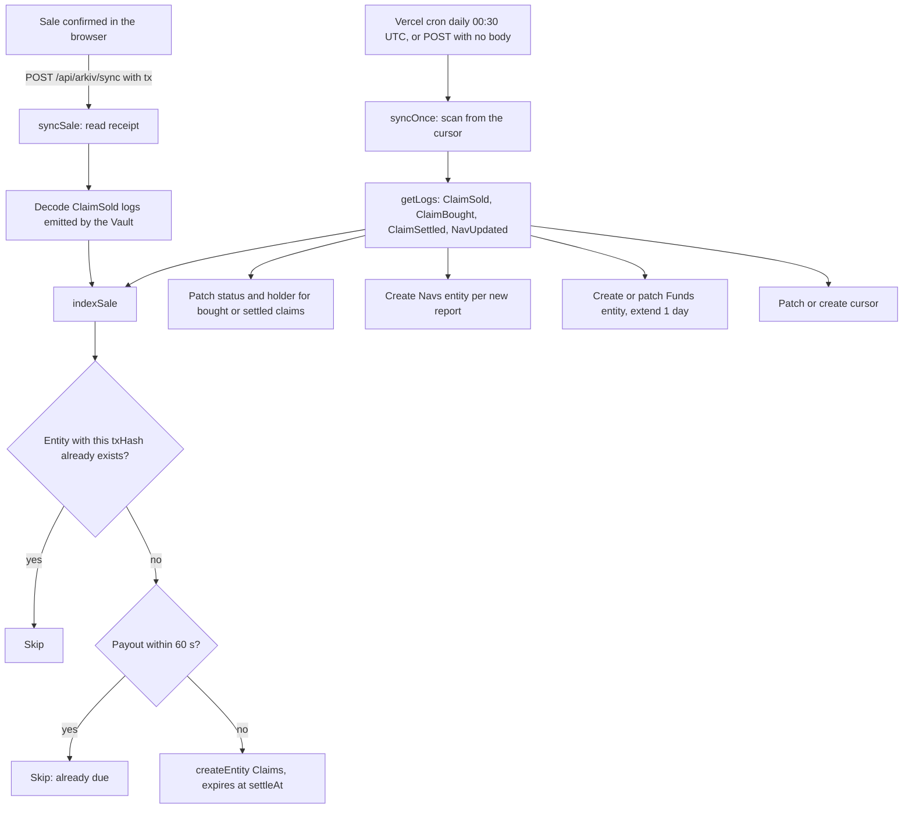

# 06. Arkiv: the public book

Every sale on Arc is copied to Arkiv as a public record that anyone can query without Earlyout's server, and that deletes itself on the claim's payout date. The Book screen (`/book`) and the vault's positions read only from Arkiv.

| Item | Value |
|---|---|
| Network | Arkiv Rabdi testnet, chain 7794095 (`rabdi` from `@arkiv-network/sdk/chains`) |
| Explorer | https://rabdi.explorer.arkiv.network |
| Writer wallet | `0x343F684dAFFf216CDf38a40888662148eBa07Fd7` (writes are paid in tGLM) |
| SDK | `@arkiv-network/sdk` ^1.0.1 |
| Schemas | `web/src/server/arkiv/schema.ts` |
| Writer | `web/src/server/arkiv/sync.ts` via `/api/arkiv/sync` |
| Reader | `web/src/server/arkiv/read.ts` via `/api/book` |
| Client setup | `web/src/server/arkiv/client.ts` (`ARKIV_ACCESS_KEY` optional, `ARKIV_WRITER_PRIVATE_KEY` for writes) |

## Schemas

Four schemas, declared with `defineSchema`. Indexed columns are the ones a query filters or sorts on. Number conventions follow the contracts: USDC amounts are 6dp integers, claim amounts and NAV are 18dp, timestamps are unix seconds, spread terms are bps.

### `earlyout.claims`, one per sale

| Column | Type | Indexed | Meaning |
|---|---|---|---|
| `claimId` | str | yes | ERC-1155 id, `0x` + 64 hex chars |
| `fund` | addr | yes | Fund token on Arc |
| `symbol` | str | yes | Fund symbol |
| `settleAt` | u64 | yes | Payout date; the entity expires at this moment |
| `status` | str | yes | `open`, `bought` or `settled` |
| `amount` | u256 | | Claim units sold (18dp) |
| `usdcPaid` | u256 | | USDC the seller received (6dp) |
| `nav` | u256 | | NAV used (18dp) |
| `baseBps`, `utilBps`, `timeBps`, `creditBps` | i32 | | The four spread terms |
| `seller` | addr | | The `receiver` of `ClaimSold` |
| `holder` | addr | | The vault, or a buyer after `ClaimBought` |
| `txHash` | str | | Arc transaction of the sale |
| `soldAt` | u64 | | Block time of the sale |

Expiry: `ExpirationTime.atDate(settleAt)`.

### `earlyout.funds`, one per fund

Indexed: `fund`, `symbol`, `status` (`ok` or `failed`). Stored: `name` (first 120 characters), `nav`, `navUpdatedAt`, `settlementDelay`, `window`, `capUsdc`, `deployedUsdc`. Created or patched whenever the fund has a `NavUpdated` event in a scan, then extended to expire one day later. If the indexer stops, the directory disappears instead of showing stale prices.

### `earlyout.navs`, one per NAV report

Indexed: `fund`, `updatedAt`. Stored: `nav`, `status`, `txHash`. Expires after 30 days. A public history of accepted reports; the app's screens read live NAV from Arc, not from here.

### `earlyout.cursor`, one entity

Indexed: `chainId`. Stored: `lastBlock`. The indexer's position on Arc. Expires after 180 days.

## Writing



### Per-sale path (`syncSale`)

After `useSell` succeeds, the browser posts `{"tx": "<hash>"}` to `/api/arkiv/sync`. The server reads the receipt from Arc, decodes only `ClaimSold` logs emitted by the configured Vault, reads the claim's fund and payout date from `ClaimWrapper.claimFund` and `claimSettleAt`, and writes one `Claims` entity. Each transaction hash is handled at most once per server instance (an in-memory set of up to 1,000 recent hashes), and the entity is skipped if one with the same `txHash` already exists for that claim id. Several sales can share a claim id (same fund, same payout window), so the check is per transaction, not per id.

### Block scan (`syncOnce`)

Runs on a `GET` or a `POST` with no body. Single flight per instance and debounced to once every 30 seconds (a second call returns the previous report).

1. Read the cursor (`ownedBy` the writer). With no cursor, start at `ARC_DEPLOY_BLOCK`.
2. Scan from `lastBlock + 1` for at most `MAX_RANGE = 5,000` blocks, up to the chain head.
3. Index any `ClaimSold` the per-sale path missed.
4. For each `ClaimBought` (status `bought`, holder = buyer) and `ClaimSettled` (status `settled`, holder = vault), patch every `Claims` entity with that claim id.
5. For each `NavUpdated` not already recorded (matched on `fund` and `updatedAt`), create a `Navs` entity.
6. For each fund touched by a NAV update, read terms, NAV, cost, name and symbol from Arc and create or patch its `Funds` entity, then extend it to expire in one day.
7. Patch the cursor to the last scanned block. If nothing was found and the window moved less than 2,000 blocks, skip this write so an empty run costs no transaction.

Each run scans one window of at most 5,000 blocks. If the indexer falls further behind than that, it needs several runs (or POSTs) to catch up; the per-sale path keeps new sales visible in the meantime.

Response shape (`SyncReport`):

```json
{
  "fromBlock": "71057910",
  "toBlock": "71062909",
  "claimsCreated": 0,
  "claimsPatched": 0,
  "navsWritten": 0,
  "fundsRefreshed": 0,
  "skipped": [],
  "txHashes": []
}
```

## Reading

All reads filter `ownedBy(writer)`. Arkiv does not stop another wallet from creating entities under the same schema name, so an unfiltered read could show forged rows.

| Function | Query | Used by |
|---|---|---|
| `openClaims()` | `select().from(Claims).where(eq("status","open")).ownedBy(writer).orderBy(asc("settleAt")).limit(100)` | `/api/book`, Book screen, Vault positions |
| `fundDirectory()` | `select().from(Funds).ownedBy(writer).orderBy(asc("symbol")).limit(100)` | `/api/book` (`funds`) |

`/api/book` returns:

```json
{
  "claims": [ { "key": "0x…", "claimId": "0x…", "fund": "0x…", "symbol": "ACREDd", "settleAt": 1794527000, "status": "open",
                "amount": "1000000000000000", "usdcPaid": "1039735", "nav": "1112612770000000000000",
                "baseBps": 50, "utilBps": 58, "timeBps": 4, "creditBps": 150,
                "seller": "0x…", "holder": "0x7A40…2319", "txHash": "0x…", "soldAt": 1794526100,
                "expiresAt": 1794527000, "owner": "0x343F…7Fd7" } ],
  "funds": [ ],
  "writer": "0x343F684dAFFf216CDf38a40888662148eBa07Fd7",
  "explorer": "https://rabdi.explorer.arkiv.network",
  "source": "arkiv:rabdi"
}
```

(Values above are illustrative.) Big integers are plain decimal strings here, not the `"123n"` wire format the other read routes use. The response is cached 5 seconds per server instance; the browser refetches every 10 seconds (`useBook`). In mock mode the route returns `mockBook()` from `web/src/lib/source/mockBook.ts` with `source: "mock"`.

Each Book row links to `https://rabdi.explorer.arkiv.network/entity/<key>` and to the Arc transaction.

### Run the query yourself

```bash
cd web && pnpm install && pnpm arkiv:query      # Node 22.10 or later
```

`web/scripts/arkiv-query.ts` runs the open-claims query against the public RPC and prints one line per claim. It defaults to the writer above; `ARKIV_WRITER_ADDRESS` and `ARKIV_ACCESS_KEY` override.

## Expiry summary

| Entity | Expires | Effect |
|---|---|---|
| Claims | at the payout date | A claim leaves the Book when it is due, with no delete code |
| Funds | one day after its last refresh | A stopped indexer cannot leave stale prices |
| Navs | 30 days | Bounded history |
| Cursor | 180 days | Re-created from `ARC_DEPLOY_BLOCK` if it ever lapses |

## What stays off Arkiv

Wallet identity, KYC status and allowlists. Arkiv holds what a distributor's dashboard needs and nothing about who a person is.

## Caveats

- There is no unique key in Arkiv, so idempotent writes need a read first (the `txHash` check).
- A `ClaimBought` patches every entity for that claim id to `bought`, even after a partial buy. The parked Buy feature narrows buys to whole claims for this reason (see [11-roadmap.md](11-roadmap.md)).
- The spec listed a fifth schema for bids; it was never built.
- More detail and the Arkiv judging write-ups: `arkiv/schema.md`, `arkiv/how-you-use-arkiv.md`, `arkiv/friction.md`, `arkiv/why-arkiv.md`, `arkiv/reach.md`.
