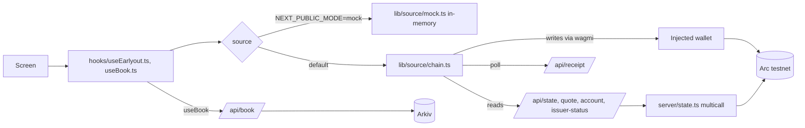

# 07. Web app

`web/` is a Next.js 16.4.5 app (App Router, React 19.3, Tailwind CSS v4, wagmi 3 and viem 2, TanStack Query 5, `motion`, `lucide-react`). It holds three things:

- the marketing site, route group `src/app/(site)`;
- the app screens, route group `src/app/(app)`;
- the backend: API routes under `src/app/api` and server-only modules under `src/server`.

`web/AGENTS.md` warns that this Next.js version has breaking changes; read the guides in `node_modules/next/dist/docs/` before writing route, layout, redirect or font code. Package manager: pnpm (`packageManager: pnpm@12.4.2`).

## Routes

Two states exist today. `main` is what https://earlyout.vercel.app serves. Branch `redesign` (working tree, uncommitted) renames the site pages and is adding new app screens; see [11-roadmap.md](11-roadmap.md).

### Site pages

| `main` (live) | `redesign` | Content |
|---|---|---|
| `/` | `/` | Landing page. Redesign: hero with a live per-unit ACRED quote sheet and three audience doors |
| `/how-it-works` | `/holders` | How a sale works, the four terms, safety rules, FAQ |
| (none) | `/liquidity` | LP page; currently a header only |
| `/distributors` | `/platforms` | Offer for distributors and issuers |
| `/developers` | `/docs` | Contracts, quote call, HTTP API, report encoding, how to run |
| `/security` | `/security` | Review findings and trust assumptions |
| `/about` | `/company` | Team and story |
| `/legal` | `/legal` | Testnet notice |

On `redesign`, `next.config.ts` redirects `/how-it-works`, `/distributors`, `/developers` and `/about` permanently to their new paths. `sitemap.ts` and `robots.ts` build from `PUBLIC_ROUTES` in `web/src/lib/site.ts`; `robots` disallows `/api/`.

### App screens

| Route | Title | What it does | Hooks |
|---|---|---|---|
| `/sell` | Sell | Fund table with indicative bids, amount input, live quote card (verdict, four terms, payout, minimum received, payout date, capacity), sell button, receipt. "Try as judge" (redesign: "Get test tokens") sets up a visitor wallet | `useFunds`, `useVault`, `useAccountState`, `useQuote`, `useSell`, `useTryAsJudge`, `useWallet` |
| `/book` | Book | Open claims from Arkiv, filter by fund, links to each Arkiv entity and Arc transaction | `useBook` |
| `/vault` | Vault | Share price, total assets, idle and deployed USDC, deposit and withdraw, per-fund exposure, positions (from Arkiv) | `useVault`, `useFunds`, `useBook`, `useAccountState`, `useDeposit`, `useWithdraw` |
| `/status` | Oracle and risk | Per-fund health (NAV age against `maxAge`, exposure against cap, issuer status, impairment), Mark impaired, and Demo controls (demo key field, simulate issuer failure or restore, push NAV) | `useFunds`, `useIssuerFailed`, `useMarkImpaired`, `useSetIssuerFailed`, `usePushNav` |

Planned on `redesign` and listed in `PUBLIC_ROUTES` already, but with no page yet: `/sales` (My sales), `/positions`, `/buy`, `/api-access`.

The app layout wraps every screen in `AppShell` (header, `Toolbar` with tabs Sell, Book, Vault, Risk). `ConfigNotice` shows an error banner when chain mode is missing contract addresses.

## Data layer



### The `Source` interface

Defined in `web/src/lib/types.ts`; `web/src/lib/source/index.ts` picks the implementation once from `MODE`.

```ts
interface Source {
  readonly mode: "mock" | "chain";
  funds(): Promise<Fund[]>;
  quote(fund: Address, amount: bigint): Promise<Quote>;
  vault(): Promise<VaultState>;
  account(address: Address): Promise<Account>;
  issuerFailed(): Promise<boolean>;
  sell(fund: Address, amount: bigint, minPayout: bigint): Promise<Receipt>;
  deposit(amount: bigint): Promise<Receipt>;
  withdraw(amount: bigint): Promise<Receipt>;
  markImpaired(fund: Address): Promise<Receipt>;
}
```

Key types: `Fund` (address, symbol, name, `nav` 18dp, `navUpdatedAt`, `status` 0 or 1, `impaired`, `settlementDelay`, `window`, `maxAge`, `capUsdc`, `deployedUsdc`, `volBps`, `creditBps`), `Quote` (the contract's quote plus `settleAt` and `value` at NAV, 6dp), `VaultState` (`totalAssets`, `idle`, `deployed`, `sharePrice`, `totalSupply`, `shareDecimals`, `baseBps`, `utilSlopeBps`), `Account` (`usdc`, `fundBalances`, `shares`, `sharesValue`, `maxWithdraw`, `maxDeposit`), `Receipt` (`hash`, optional `claimId` and `payout`).

### Mock and chain mode

| | Chain mode (default) | Mock mode |
|---|---|---|
| Set by | `NEXT_PUBLIC_MODE` unset or anything but `mock` | `NEXT_PUBLIC_MODE=mock` |
| Funds | All listed funds from FundRegistry | ACRED and ACREDd with fake addresses, NAV 1113.7732 |
| Quotes | `Vault.quoteFund` through `/api/quote` | Same integer formula in memory, shorter verdict list |
| Wallet | Injected wallet via wagmi, on Arc testnet | Fixed fake account, always connected, 250 USDC and 2 units of each fund |
| Writes | Real transactions | In-memory state change after a short delay, fake hash |
| Book | Arkiv via `/api/book` | `mockBook()` sample |
| Demo switches | Need `DEMO_TOKEN` | Work without a key |

Mock mode is opt-in only and never a fallback: if chain mode is missing addresses, the app shows `ConfigNotice` rather than switching. Mock state is per server or browser process and resets on reload.

### Chain-mode writes (`lib/source/chain.ts`)

1. `ensureChain` switches the wallet to Arc testnet (5042002) if needed.
2. `ensureAllowance` reads the allowance through `/api/account?address=&token=&spender=` and, if short, sends `approve(spender, maxUint256)`.
3. The write is sent with wagmi `writeContract`:
   - sell: `ClaimWrapper.depositAndSell(fund, amount, minPayout)`, with `minPayout = payout × 995 / 1000` set by the Sell screen;
   - deposit: `Vault.deposit(amount, me)` after approving USDC to the vault;
   - withdraw: `Vault.withdraw(amount, me, me)`;
   - mark impaired: `Vault.markImpaired(fund)`.
4. `waitReceipt` polls `/api/receipt?hash=` (800 ms rising to 2.5 s, up to 3 minutes). A reverted receipt throws.
5. After a sale, the `ClaimSold` log is decoded to return `claimId` and `payout`, and `useSell` posts the hash to `/api/arkiv/sync`.
6. The next state read adds `fresh` so the result shows at once.

## Hooks

| Hook | File | Query key, refresh |
|---|---|---|
| `useWallet` | `hooks/useEarlyout.ts` | wagmi account; fixed mock account in mock mode |
| `useFunds` | same | `["funds"]`, every 60 s |
| `useQuote(fund, amount)` | same | `["quote", fund, amount]`, every 30 s, keeps the previous value while loading |
| `useVault` | same | `["vault"]`, every 60 s |
| `useAccountState` | same | `["account", address]`, every 30 s |
| `useIssuerFailed` | same | `["issuerFailed"]`, every 20 s |
| `useSell`, `useDeposit`, `useWithdraw`, `useMarkImpaired` | same | Mutations; invalidate every query when settled |
| `useSetIssuerFailed`, `usePushNav` | same | Call the demo routes with the `x-demo-token` header from `sessionStorage` key `earlyout-demo-key` |
| `useTryAsJudge` | same | `POST /api/demo/judge` |
| `useBook` | `hooks/useBook.ts` | `["book"]`, every 10 s |
| `useNow` | `hooks/useNow.ts` | Unix seconds, ticking every 30 s by default |

The QueryClient (`components/Providers.tsx`) uses `staleTime` 10 s, 4 retries with exponential backoff up to 8 s, and no refetch on window focus.

## Server modules

All are `server-only`.

| Module | Job |
|---|---|
| `server/env.ts` | Validates server env (`serverEnv`); `cronAuthorized` (Bearer `CRON_SECRET`), `demoAuthorized` (`x-demo-token` vs `DEMO_TOKEN`), both constant-time and failing closed; `publicError` trims errors to one line and strips RPC URLs |
| `server/arc.ts` | Arc public client and the ops wallet client (from `OPS_PRIVATE_KEY`) |
| `server/state.ts` | `readState` (funds and vault, 10 s cache, 5 min last-good fallback), `readQuote` (10 s per fund and amount, amount must be 1 to 1e30), `readAccount` (4 s per wallet), `readAllowance` (only USDC and listed fund tokens, only the vault or wrapper as spender), `readReceipt`, `readIssuerFailed` (5 s cache) |
| `server/limit.ts` | In-memory rate limit per route and client IP, per server instance |
| `server/nav.ts` | NAV pusher (see [05-oracle-and-cre.md](05-oracle-and-cre.md)) |
| `server/arkiv/*` | Arkiv client, schemas, reads and sync (see [06-arkiv.md](06-arkiv.md)) |

## API endpoints

Routes marked "wire" return JSON where every bigint is a string ending in `n` (`"1039735n"`); `lib/wire.ts` (`toWire`, `fromWire`) converts both ways. All `/api/*` responses carry `Cache-Control: no-store` from `next.config.ts` unless the route sets its own.

| Method and path | Limit per IP per min | Auth | Request | Response |
|---|---|---|---|---|
| `GET /api/state` | 60 | none | optional `?fresh` (honoured at most every 5 s) | wire `{ funds: Fund[], vault: VaultState }`; edge cache `s-maxage=10, stale-while-revalidate=50` unless fresh |
| `GET /api/quote` | 60 | none | `?fund=<address>&amount=<integer, 18dp, up to 40 digits>` | wire `Quote`; 400 for a bad input, an unlisted fund or an amount out of range; edge cache 10 s |
| `GET /api/account` | 120 | none | `?address=` [`&fresh`] | wire `Account` |
| `GET /api/account` | 120 | none | `?address=&token=&spender=` | wire `{ allowance }`; 400 for an unsupported token or spender |
| `GET /api/receipt` | 240 | none | `?hash=<0x + 64 hex>` | `{ status: "pending"|"success"|"reverted", logs: [{ address, data, topics }] }` |
| `GET /api/book` | 30 | none | | `{ claims, funds, writer, explorer, source }` (see [06-arkiv.md](06-arkiv.md)) |
| `GET /api/issuer-status` | 60 | none | optional `?fund=` (echoed) | `{ status: "OK"|"FAILED", fund, source, at }` |
| `POST /api/issuer-status` | 10 | `x-demo-token` (not needed in mock mode) | `{ "failed": boolean }` | `{ status, hash }` after `IssuerStub.setFailed` confirms |
| `GET` or `POST /api/nav/push` | 6 | Bearer `CRON_SECRET` or `x-demo-token` | | `{ mode, results: [{ fund, feed, nav, decimals, updatedAt, status, hash }] }`; 503 if the ops wallet is under 2 USDC |
| `GET` or `POST /api/arkiv/sync` | 12 | none (idempotent, debounced, single flight) | optional `{ "tx": "0x…" }` | `SyncReport`; in mock mode `{ mode: "mock", synced: 0 }` |
| `POST /api/demo/judge` | 5, plus 20 new wallets per hour per instance | none, or `x-demo-token` equal to `JUDGE_TOKEN` when that is set | `{ "address": "0x…" }` | `{ ok, funds, transactions }`; 403 off Arc testnet, 503 if the ops wallet is low |

Errors are `{ "error": "<one line>" }` with 400, 401, 429, 502 or 503.

`/api/demo/judge` allowlists the visitor on every listed fund token and on ClaimToken, mints 0.05 units of each fund if the wallet holds less, and sends 0.2 USDC of gas if its native balance is under 0.1. It never spends the ops wallet below 2 USDC.

A plain quote from the command line:

```bash
curl "https://earlyout.vercel.app/api/quote?fund=0xCd5DE841b0f781A866cA6E978A19d6d5431683E2&amount=1000000000000000"
```

## Environment variables

Names only. Copy `web/.env.example` to `web/.env.local`; `pnpm sync-addresses` fills in the contract addresses and `ARC_DEPLOY_BLOCK` from `contracts/deployments/arc-testnet.json`.

| Variable | Scope | Required | Purpose |
|---|---|---|---|
| `NEXT_PUBLIC_MODE` | public | no | `mock` for in-memory demo data; anything else is chain mode |
| `NEXT_PUBLIC_ARC_RPC` | public | no | Arc RPC for wagmi (default `https://rpc.testnet.arc.io`) |
| `NEXT_PUBLIC_FUND_REGISTRY`, `NEXT_PUBLIC_NAV_ORACLE`, `NEXT_PUBLIC_ISSUER_STUB`, `NEXT_PUBLIC_CLAIM_TOKEN`, `NEXT_PUBLIC_CLAIM_WRAPPER`, `NEXT_PUBLIC_VAULT` | public | chain mode | Contract addresses |
| `NEXT_PUBLIC_TESTNET` | public | no | Redesign branch: `false` hides the testnet strip and test-token helpers. Not in `.env.example` |
| `ARC_RPC` | server | no | Server-side Arc RPC (defaults to `NEXT_PUBLIC_ARC_RPC`) |
| `OPS_PRIVATE_KEY` | server secret | for demo routes and NAV push | Ops wallet: owner of every contract and the oracle forwarder |
| `DEMO_TOKEN` | server secret | for demo switches | Required in `x-demo-token` for the issuer switch and NAV push |
| `JUDGE_TOKEN` | server secret | no | If set, `/api/demo/judge` requires it |
| `CRON_SECRET` | server secret | no | Bearer token Vercel cron sends to `/api/nav/push` |
| `FUND_FEEDS` | server | for NAV push | `fund:feed` pairs, comma separated |
| `ETH_RPC` | server | no | Ethereum mainnet RPC for the pusher |
| `ARC_DEPLOY_BLOCK` | server | for Arkiv scan | First block the indexer scans |
| `ARKIV_ACCESS_KEY` | server secret | no | Faster Arkiv RPC access |
| `ARKIV_WRITER_PRIVATE_KEY` | server secret | for Arkiv writes | Arkiv writer wallet |
| `ARKIV_WRITER_ADDRESS` | server | for Book reads | Every read filters `ownedBy` this address |

Playwright reads `E2E_BASE_URL` and `CI`. The CRE workflow uses `CRE_ETH_PRIVATE_KEY` in `cre/.env`. The deploy script reads the variables listed in [03-contracts.md](03-contracts.md#deploy-script).

## Scripts (`web/package.json`)

| Script | What it does |
|---|---|
| `pnpm dev`, `pnpm build`, `pnpm start` | Next.js |
| `pnpm lint`, `pnpm typecheck`, `pnpm check` | ESLint, `tsc --noEmit`, both |
| `pnpm test:unit` | `node --experimental-strip-types --test "test/**/*.test.ts"` |
| `pnpm test:e2e` | Playwright |
| `pnpm sync-addresses` | Copy deployed addresses into `.env.local` |
| `pnpm check:abi` | Check every signature in `src/lib/abi.ts` exists in `contracts/out` (run `forge build` first) |
| `pnpm arkiv:query` | Print open claims from Arkiv |
| `pnpm impair mark|clear <fund> [fund…]` | Owner tool: `markImpaired` or `clearImpaired` with the ops key from `.env.local` |

## Security headers

`next.config.ts` sets `X-Content-Type-Options: nosniff`, `Referrer-Policy: strict-origin-when-cross-origin`, `X-Frame-Options: SAMEORIGIN`, a `Permissions-Policy` that disables camera, microphone, geolocation and payment, and `Cross-Origin-Opener-Policy: same-origin-allow-popups`. `poweredByHeader` is off.

## Theme

`themeScript` in `components/ThemeToggle.tsx` runs before first paint and applies the `dark` class from `localStorage.theme` or the system preference. On `redesign` the fonts are Instrument Serif, Geist and Geist Mono through `next/font/google`.
